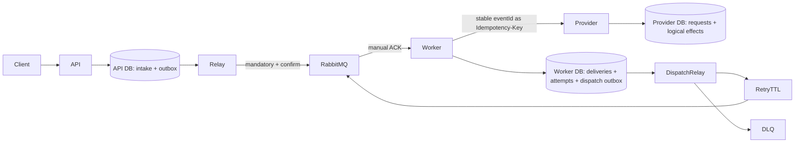

# Architecture and ownership

Three deployables, three PostgreSQL databases, one RabbitMQ broker. No component queries another component's database. The provider database models an external system's independent transactional boundary.

`notifyflow-contracts` contains only immutable transport DTOs and validation. `notifyflow-messaging` contains transport topology and confirmed outbox publication. It shares a table *shape*, never a table instance. API and worker migrations own their respective tables. The tests module is not deployable.

The API writes with explicit JDBC SQL inside Spring transactions to make `ON CONFLICT` and locking semantics visible. Spring Data JPA/Hibernate validates the notification entity mapping; there is no generated schema. Worker and provider use JDBC and Flyway, without artificial entities or repositories. UTC `Clock` is injected for business timestamps. Broker TTL uses the broker's own clock, not the Java clock.

Notification intake status is always `ACCEPTED`: it records the acceptance fact, not a projection of broker/worker state. Outbox status is `PENDING` or `PUBLISHED`. Worker delivery status is `PENDING`, `RETRYING`, `DELIVERED`, or `DEAD_LETTERED`; attempts have their own outcome. `DEAD_LETTERED` means a durable dispatch decision, while the worker outbox's `published_at` proves transfer to the broker. API delivery/attempt reads proxy the worker's bounded internal read API with timeouts. API acceptance and notification reads do not depend on worker availability.

## Boundaries and failure windows

1. Intake key and canonical DTO JSON, notification, initial event commit together. The deferred FK permits key arbitration before inserting the notification. The primary key on `intake_keys.key` serializes concurrent duplicates. Same key/payload returns the same identity and 202; different payload returns 409.
2. Relay selects one due row at a time using `FOR UPDATE SKIP LOCKED`, at most 20 per poll. Lock survives publication confirmation and status update. A crash after broker confirm but before commit causes a duplicate, which is intentional. Failure retains the row and schedules capped 2–60 second exponential backoff.
3. Worker first commits a unique event identity, then locks it during a bounded provider request and bookkeeping transaction. A concurrent redelivery blocks on that lock. This intentionally uses a short database transaction across HTTP: simpler correctness proof at the expense of connection occupancy. Pool size 6, consumer concurrency 2, prefetch 1. Do not scale consumers beyond database capacity without redesign.
4. Successful processing commits an attempt and delivery result before ACK. Transient failure commits an attempt, new delivery generation and retry-dispatch outbox atomically before ACK. Permanent/exhausted failure commits a DLQ-dispatch outbox before ACK. Stale generation duplicates are ACKed with a duplicate metric.
5. Provider effect and worker commit are separate transactions. After provider success and worker crash, RabbitMQ redelivers and provider's unique stable key returns the existing logical effect. The attempt history records committed decisions; a crash can roll back the interrupted attempt. Provider `calls` exposes the extra physical request in tests.

No distributed transaction, exactly-once transport, global ordering, automatic DLQ redrive, retention cleanup, authentication or multi-node broker availability is claimed. Invalid/incompatible messages are rejected to the main quorum queue's safe DLX. Their bytes and AMQP metadata remain inspectable.

## Versions and compatibility

Java 21; Spring Boot 3.5.16; Spring AMQP, JPA, Flyway, JUnit, AssertJ, Awaitility and Testcontainers managed by its BOM; springdoc 2.10.0; Maven Wrapper 3.3.4 / Maven 3.9.16; PostgreSQL 17.11-alpine; RabbitMQ 4.2.5-management-alpine; Temurin 21.0.13_9 runtime. No snapshot/RC versions. Exact resolved versions are available with `./mvnw dependency:tree`.

Compatibility references: [Boot requirements](https://docs.spring.io/spring-boot/3.5/system-requirements.html), [springdoc matrix](https://springdoc.org/v2/), [RabbitMQ confirms](https://www.rabbitmq.com/docs/confirms), [safe DLX](https://www.rabbitmq.com/docs/dlx). Boot 3.5 retains the established Spring 6/Jakarta stack and covers Java 21 without adopting a new major stack for this milestone.

## Contract evolution

The envelope explicitly carries `eventType`, `eventVersion`, `eventId`, `notificationId`, UTC `occurredAt`, `correlationId`, `generation`, and a DTO payload. Entities are never serialized. Consumers currently reject unknown fields as well as unknown versions. Even additive changes therefore require coordinated consumer rollout or a new versioned contract/topology. Never reinterpret v1 fields in place. Schema Registry is unnecessary for this bounded JSON contract.
